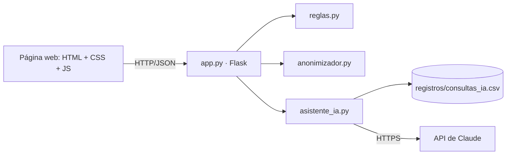
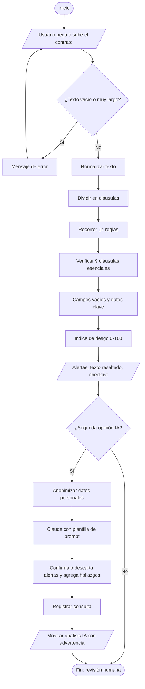

# Bitácora del proyecto: Lupa Legal

Registro paso a paso de cómo se construyó la página, para la exposición y para armar la PPT.
Fecha de desarrollo: 22 de noviembre de 2026. Herramienta: **Claude Code**, la IA agéntica vista en la Sesión 13 ("Creemos una página web usando Claude Code").

**Versiones**
- **Versión 1 (pasos 0 a 12):** analizador de contratos por reglas, con segunda opinión de IA y chatbot.
- **Versión 2 (pasos 13 a 19):** se integró la **calculadora de plazos de la EC1**. Se sumaron resoluciones, casaciones y escritos, la lectura de PDF (también fotocopiados), Word e imágenes, y la IA ahora funciona **sin clave de API**.

Para recorrer el código en VS Code, ver [GUIA_DEL_CODIGO.md](GUIA_DEL_CODIGO.md).

---

## Paso 0: El encargo

**Consigna:** crear una página web que analice el texto de un contrato y señale los aspectos que requieren revisión. Debía mejorar la idea inicial, aplicar los lineamientos del curso y usar a Claude como chatbot o asistente para obtener respuestas más rápidas.

**Instrucción que le dimos a Claude Code (resumen):** "Mejora la idea de la EC1: crea una página web que analice el texto de un contrato y señale aspectos que requieran revisión. Usa todos los lineamientos vistos en clase y los repositorios. Usa a Claude como chatbot o asistente. Registra todo paso a paso para la exposición."

Esto es **vibe coding con supervisión**: describimos lo que queremos, la IA genera el código y nosotros revisamos, probamos e iteramos.

---

## Paso 1: Revisión del material del curso

Antes de programar, Claude Code leyó la carpeta del curso para alinear el proyecto con lo enseñado:

| Fuente | Qué se tomó para el proyecto |
|---|---|
| Semana 1: Pensamiento computacional | Descomponer, reconocer patrones, abstraer y algoritmo. Esquema **Entrada → Proceso → Salida** |
| Semana 2: Primeros pasos (Python, VS Code, Git, Terminal) | Proyecto en Python, ejecutable desde la terminal y listo para GitHub |
| Repositorio `python-intro` | Estilo de código: comentarios en español, `strip()` y `lower()`, búsqueda de palabras clave (`04-buscar-palabra-clave.py`), lectura de archivos y CSV |
| EC1: plazos penales | Datos como **lista de diccionarios** y funciones que la recorren con `for` e `if`. Además corrige la limitación de las tildes ("casación" ≠ "casacion") |
| Semana 6: BPMN y Mermaid | Diagrama del flujo del proceso hecho con Mermaid |
| Semana 9: Internet (HTML, JavaScript, frontend y backend) | Página en HTML, CSS y JavaScript (frontend) con servidor en Python y Flask (backend) |
| `mi_pagina_web` (ejercicios 1 a 3) | Estructura HTML semántica (`header`, `nav`, `main`, `section`, `footer`) y varias páginas enlazadas |
| Sesión 10: Cloud y ciberseguridad | Confidencialidad (anonimización), clave de API fuera del código (`.env`), validación de entradas |
| Sesiones 12 y 13: IA, LLM y prompt engineering | Plantilla de prompt (rol, contexto, formato, criterios), riesgos de los LLM y controles de integración responsable |
| Manual del curso: rúbrica EC1 | Investigación, calidad técnica, presentación, repositorio GitHub y postura Derecho–Tecnología |

**Idea clave de la Sesión 13 que guió el diseño:** "Plantilla de revisión de contratos que incluya: rol del modelo, alcance, formato de respuesta, criterios de análisis y limitaciones." Así está construido el prompt del proyecto.

---

## Paso 2: Pensamiento computacional aplicado al problema

**Problema jurídico:** antes de firmar un contrato, muchas personas no detectan cláusulas que las perjudican. La revisión manual toma tiempo y es fácil pasar algo por alto.

| Operación | Aplicación |
|---|---|
| **Descomponer** | Revisar un contrato = (1) dividirlo en cláusulas, (2) buscar cláusulas riesgosas, (3) verificar cláusulas esenciales, (4) detectar espacios sin completar, (5) extraer montos, plazos y fechas, (6) calcular un índice de riesgo |
| **Reconocer patrones** | Las cláusulas riesgosas usan frases parecidas: "no será responsable", "de manera unilateral", "renuncia a", "sin previo aviso", "capitalizable" |
| **Abstraer** | Cada riesgo es un registro con: id, categoría, título, nivel, patrones, explicación, recomendación y base legal |
| **Algoritmo** | Normalizar → dividir → recorrer reglas → buscar patrones → ubicar cláusula → sumar puntos → mostrar |

**Pseudocódigo:**

```text
INICIO
  LEER texto_contrato
  SI texto_contrato está vacío ENTONCES
      MOSTRAR "Pega el texto de un contrato"
      TERMINAR
  FIN SI
  normal ← texto en minúsculas y sin tildes
  clausulas ← dividir texto por "CLÁUSULA", "PRIMERA", "SEGUNDA"...
  PARA CADA regla EN reglas HACER
      PARA CADA patron EN regla.patrones HACER
          SI patron aparece en normal ENTONCES
              GUARDAR alerta (regla, cláusula, fragmento)
          FIN SI
      FIN PARA
  FIN PARA
  PARA CADA clausula_esencial EN esenciales HACER
      SI no aparece ENTONCES marcar como faltante
  FIN PARA
  indice ← suma de puntos (alto = 15, medio = 8, bajo = 3, faltante = 6)
  MOSTRAR índice, alertas, texto resaltado y checklist
FIN
```

---

## Paso 3: Diseño de la solución (arquitectura)

Se eligió una solución **híbrida**: reglas y además IA.

- **Reglas (programación tradicional):** transparentes, predecibles, gratuitas y sin internet, pero rígidas porque buscan palabras.
- **IA (Claude):** entiende el sentido de la cláusula, pero puede equivocarse y requiere controles.
- **Combinación:** la IA revisa las alertas de las reglas y las **confirma, matiza o descarta**. El abogado decide al final.



**Flujo completo (Mermaid):**



---

## Paso 4: Preparación del entorno

```bash
mkdir revisor-contratos
cd revisor-contratos
python3 -m venv .venv          # entorno virtual (aislado del resto del sistema)
.venv/bin/pip install flask anthropic
```

- **Flask 3.1:** crea el servidor web en Python.
- **anthropic 2.12:** SDK oficial para conectarse con Claude.
- `.gitignore` excluye `.venv/`, `.env` (la clave) y `registros/`.

---

## Paso 5: Motor de reglas (`reglas.py`)

Es el corazón del proyecto y aplica directamente lo de las Semanas 2 a 4 y la EC1.

1. **Datos (lista de diccionarios):** 14 reglas (`REGLAS`) y 9 cláusulas esenciales (`CLAUSULAS_ESENCIALES`). Para agregar una regla basta con agregar un diccionario, sin tocar la lógica.
2. **`normalizar_texto()`:** pasa a minúsculas **y quita tildes** sin cambiar la longitud del texto. Así se corrige la limitación de la EC1 y se pueden resaltar las posiciones exactas en el texto original.
3. **`dividir_en_clausulas()`:** detecta "CLÁUSULA", "PRIMERA", "SEGUNDA"... para decir en qué cláusula está cada alerta.
4. **`buscar_alertas()`:** `for` sobre reglas, `for` sobre patrones, `re.finditer` (expresiones regulares) y `if` cuando hay coincidencia.
5. **`verificar_clausulas_esenciales()`:** detecta lo que **falta** (partes, objeto, precio, plazo, pago, resolución, controversias, domicilio y firma).
6. **`detectar_campos_vacios()`:** encuentra `____`, `[nombre]` o `XXX`.
7. **`extraer_datos_clave()`:** montos (S/, US$), plazos ("doce (12) meses"), fechas y porcentajes.
8. **`calcular_indice_riesgo()`:** suma puntos y asigna semáforo (bajo < 30 ≤ medio < 60 ≤ alto).

**Las 14 reglas:**

| ID | Riesgo | Nivel | Referencia orientativa |
|---|---|---|---|
| R01 | Exoneración o limitación de responsabilidad | Alto | CC arts. 1328 y 1398 |
| R02 | Resolución o terminación unilateral | Alto | CC arts. 1365, 1398 y 1430 |
| R03 | Penalidad o cláusula penal | Medio | CC arts. 1341 a 1346 |
| R04 | Renovación o prórroga automática | Medio | CC arts. 1398 y 1700 |
| R05 | Modificación unilateral de condiciones o precio | Alto | CC art. 1361; Ley 29571 |
| R06 | Renuncia a derechos o acciones | Alto | CC art. V T.P. y art. 1398 |
| R07 | Intereses, moras o capitalización | Medio | CC arts. 1243 y 1249 |
| R08 | Jurisdicción, arbitraje o sede desfavorable | Medio | CPC art. 25; D. Leg. 1071 |
| R09 | Tratamiento de datos personales | Medio | Ley 29733 |
| R10 | Cesión del contrato sin consentimiento | Medio | CC art. 1435 |
| R11 | Exclusividad o no competencia | Medio | CC art. 1354 |
| R12 | Confidencialidad indefinida | Bajo | CC art. 1354 |
| R13 | Pagos adelantados, garantías o retenciones | Bajo | CC arts. 1361 y 1362 |
| R14 | Fuerza mayor asumida por una sola parte | Medio | CC art. 1315 |

> Las referencias son orientativas y deben verificarse con la norma vigente antes de usarse en un caso real.

---

## Paso 6: Anonimización (`anonimizador.py`)

Conexión con ciberseguridad (Sesión 10) y con el riesgo de **confidencialidad** de los LLM (Sesión 13): el texto que se envía a una IA en la nube se procesa en servidores de terceros.

Antes de enviar el contrato a Claude se reemplazan los datos sensibles por etiquetas:

```text
"identificada con DNI N° 47852369, correo lucia.fernandez@correo.com"
→ "identificada con DNI N° [DNI], correo [CORREO]"
```

Se detectan: correo, cuenta bancaria, RUC, partida registral, DNI y teléfono. El usuario puede presionar **"Ver qué se enviaría"** para revisar el texto antes del envío.

---

## Paso 7: Integración con Claude (`asistente_ia.py`)

### 7.1 Plantilla de prompt (prompt engineering de la Sesión 13)

| Técnica de clase | Cómo se aplicó |
|---|---|
| Dar contexto explícito (rol, audiencia, propósito) | "Eres un abogado peruano especialista en contratos… apoyas a un estudiante o abogado que revisa un contrato antes de firmarlo" |
| Especificar el formato | JSON con esquema obligatorio (structured outputs) |
| Descomponer en pasos | Criterios numerados: tipo de contrato → cláusula por cláusula → contraste normativo → revisar alertas → recomendar |
| Limitaciones (control de alucinaciones) | "No inventes artículos ni jurisprudencia; si dudas, escribe 'Verificar norma aplicable'" |

La plantilla tiene versión (`v1.0`) para poder auditarla y mejorarla, como recomienda la diapositiva "Auditorías de prompts".

### 7.2 Salida estructurada

Claude debe devolver exactamente estos campos: `tipo_contrato`, `resumen`, `partes`, `hallazgos` (cláusula, texto citado, riesgo, problema, recomendación, fundamento), `validacion_reglas` (confirmada, matizada o descartada), `clausulas_faltantes`, `preguntas_para_el_cliente` y `conclusion`. Esto hace la respuesta **verificable**: cada hallazgo trae la cita textual para comprobarla en el contrato.

### 7.3 Chatbot "Lupa"

- Responde preguntas sobre el contrato cargado, cita la cláusula y avisa cuando algo no está en el contrato.
- Usa **streaming**: la respuesta aparece mientras se escribe, así se siente más rápida.
- Esfuerzo de razonamiento `low` en el chat (rapidez) y `medium` en el análisis (profundidad).
- Recuerda los últimos 10 mensajes de la conversación.

### 7.4 Controles de integración responsable

| Control (diapositiva "Controles e integración responsable") | Implementación |
|---|---|
| Auditoría de prompts | Plantilla fija, versionada y visible en "Cómo funciona" |
| Registro de consultas y outputs | `registros/consultas_ia.csv`: fecha, tipo, modelo, plantilla, caracteres, anonimizado, tokens y resultado (**sin guardar el contrato**) |
| Verificación humana obligatoria | Aviso "Contenido generado por IA" en cada respuesta y en el pie de página |
| Seguridad y confidencialidad | Anonimización y clave de API en `.env` (fuera del código y de GitHub) |
| Proporcionalidad | La IA es opcional: las reglas funcionan sin ella |
| Respaldo ante rechazo | Si Claude rechaza una consulta por seguridad, el servidor reintenta con un modelo alternativo (`fallbacks`) |

Modelo usado: `claude-opus-5-5`. Se puede cambiar en `.env` (por ejemplo, `claude-haiku-5-5` es más rápido y barato).

---

## Paso 8: Servidor web (`app.py`)

Rutas (API) que usa la página:

| Ruta | Qué hace |
|---|---|
| `GET /` | Muestra la página |
| `GET /api/estado` | Indica si la IA está activa y qué modelo usa |
| `GET /api/ejemplos` | Lista los contratos de ejemplo |
| `GET /api/reglas` | Publica las reglas y el prompt (transparencia) |
| `POST /api/analizar` | Análisis por reglas |
| `POST /api/anonimizar` | Vista previa del texto que se enviaría a la IA |
| `POST /api/analizar-ia` | Segunda opinión con Claude |
| `POST /api/chat` | Chatbot con respuesta en streaming |

**Validaciones:** el texto no puede estar vacío ni superar 120 000 caracteres (unas 40 páginas). Solo se pueden leer archivos de la carpeta `ejemplos/`. Los errores de la API se traducen a mensajes comprensibles ("La clave de API no es válida…").

La clave se lee del archivo `.env` con una función propia (`cargar_env`), que es un ejemplo de lectura de archivos de la Semana 4.

---

## Paso 9: La página web (`web/`)

- **`index.html`:** el analizador, organizado en tres pasos (1. texto, 2. resultado y 3. segunda opinión IA) más el chatbot flotante.
- **`como-funciona.html`:** problema jurídico, pensamiento computacional, diagramas Mermaid, tabla de reglas, prompt usado, limitaciones y postura Derecho–Tecnología.
- **`style.css`:** colores del curso (azul marino y naranja), adaptable a celular y con estilo de impresión para el informe PDF.
- **`app.js`:** envía el texto al servidor con `fetch` y muestra los resultados. Escapa el HTML para evitar inyección de código.

**Funciones de la interfaz:** cargar ejemplo o subir `.txt`, medidor de riesgo, filtros por nivel, botón "Ver en el texto" (salta y resalta la cláusula), checklist de cláusulas esenciales, datos clave, descarga de informe en PDF y chatbot con preguntas sugeridas.

---

## Paso 10: Pruebas realizadas (resultados reales)

### Contrato de arrendamiento (ejemplo con cláusulas abusivas)

- **Índice de riesgo: 100/100 (alto).** 12 alertas: 4 altas, 7 medias y 1 baja.
- Detectó: exoneración de responsabilidad (cláusula séptima), resolución unilateral con 24 horas de aviso (octava), modificación de la renta sin previo aviso (tercera), renuncia a reclamos (octava), interés del 5 % mensual capitalizable (quinta), renovación automática (segunda), cesión sin consentimiento (novena), datos personales compartidos por tiempo indefinido (décima), fuerza mayor a cargo de la arrendataria (sexta), garantía no devuelta (cuarta) y jurisdicción en Arequipa (décima primera).
- 4 espacios sin completar (fecha de firma).
- Anonimización: 2 DNI, 1 RUC, 1 correo, 1 teléfono, 1 cuenta bancaria y 1 partida registral ocultos.

### Contrato de locación de servicios (ejemplo equilibrado)

- **Índice de riesgo: 27/100 (bajo).** 4 alertas: penalidad con tope (medio), arbitraje (medio), exclusividad de 1 año (medio) y confidencialidad indefinida (bajo).
- Todas las cláusulas esenciales presentes. La resolución con requerimiento previo (art. 1429) **no** se marcó como riesgosa, que es lo correcto.

### Casos borde

| Prueba | Resultado |
|---|---|
| Texto vacío | Mensaje "Pega o carga el texto de un contrato antes de analizar" |
| Texto informal de una línea | Índice 48 (medio) y 8 cláusulas esenciales faltantes |
| Intento de leer `../app.py` por la ruta de ejemplos | Bloqueado (404) |
| IA sin clave | La página explica cómo configurarla; las reglas siguen funcionando |
| IA con clave falsa | Mensaje "La clave de API no es válida…" (sin errores técnicos) |
| Respuesta de IA simulada | Se verificó que el DNI y el correo reales **no** se envían y que la consulta se registra en el CSV |
| Vista en celular (375 px) | Sin desborde horizontal |

### Ajustes hechos tras las pruebas (iteración)

1. La cita de cada alerta cortaba en "S/ 8,400." → ahora un punto entre números no corta la oración.
2. La cita mostraba el título ("CLÁUSULA OCTAVA: PENALIDADES") → ahora prefiere el cuerpo de la cláusula.
3. Los plazos salían como "12) meses" → ahora "doce (12) meses".
4. El número de cuenta no se anonimizaba → se agregó el patrón de cuentas bancarias.
5. En celular la página se desbordaba → se corrigió la rejilla CSS.
6. El puerto 5000 choca con AirPlay en Mac → se usa el puerto 5050.

---

## Paso 11: Limitaciones y mejoras futuras

**Limitaciones:** las reglas buscan palabras, por lo que puede haber falsos positivos y omisiones. La anonimización no oculta nombres ni direcciones. Las referencias legales son orientativas. Solo procesa texto. La IA requiere clave de API, que tiene costo por uso.

**Mejoras futuras:** leer PDF y Word; reglas por tipo de contrato (laboral, consumo, compraventa); base normativa actualizable con fecha de vigencia; un modelo local para datos muy sensibles (como Whisper en la Sesión 13); exportar a Word con comentarios; publicar en la nube con usuarios y contraseñas.

---

## Paso 12: Postura Derecho–Tecnología

La tecnología **no reemplaza** el criterio jurídico: lo **amplifica**. Las reglas aportan transparencia y la IA aporta comprensión del sentido. Combinadas con controles (anonimización, trazabilidad, prompt auditado y revisión humana), permiten revisar contratos más rápido sin renunciar a la responsabilidad profesional ni al secreto profesional.

---

---

# Versión 2: retroalimentación y mejoras

## Paso 13: Retroalimentación sobre la versión 1

Al probar la versión 1 identificamos cuatro problemas:

1. **Quedó fuera el tema principal de la EC1: el cálculo de plazos.**
2. **Solo analizaba contratos.** En la práctica también se revisan casaciones, resoluciones y escritos.
3. **No se podían subir PDF.** La mayoría de contratos y casaciones son fotocopias escaneadas cuyo texto no se puede copiar y pegar.
4. **La IA no funcionaba** porque pedía una clave de API de pago.

Además, se pidió poder **mostrar el código en VS Code** y explicar cómo se relaciona con lo visto en clase.

## Paso 14: Calculadora de plazos (evolución de la EC1), `plazos.py`

Se reutilizó el código de la EC1 (`EC 1 LGAL TECH.txt`) y se mejoró:

| EC1 (consola) | Lupa Legal v2 |
|---|---|
| `feriados` 2026 como lista de textos | `FERIADOS` 2026 y 2027 como diccionario fecha → nombre ("Fiestas Patrias") |
| `es_dia_habil()` y `sumar_dias_habiles()` | Las mismas funciones, ahora con días inhábiles adicionales (suspensión de labores, huelga, feriado local) |
| `obtener_inicio_plazo()`: física +1, electrónica +3 | Se mantiene en `DESPLAZAMIENTO_NOTIFICACION` y se explica en pantalla |
| 5 recursos penales | **19 plazos**: penal (CPP), civil (CPC), laboral (Ley 29497), constitucional (Ley 31307) e investigación fiscal |
| Investigación compleja = 240 días | Se suman **meses reales** (8 y 36 meses) |
| Solo muestra la fecha final | **Calendario visual** y tabla día por día (por qué se cuenta o no cada día) |
| — | Estado frente a hoy (vencido, vence hoy, días restantes), archivo **.ics** para el calendario del celular y botón "Preguntar a Lupa" |

**Prueba con el caso de la EC1:** casación penal, notificación física el viernes 24/07/2026. Resultado: inicio el **27/07/2026** y vencimiento el **12/08/2026**. Se saltaron el 28 y 29 de julio (Fiestas Patrias), el 6 de agosto (Batalla de Junín) y los fines de semana.

La calculadora también funciona en consola igual que la EC1: `python plazos.py`.

## Paso 15: Más documentos, `tipos_documento.py`

1. **Detección automática del tipo** (reconocimiento de patrones): se cuentan pistas de cada tipo ("cláusula" y "arrendador" para un contrato; "considerando", "sala" y "resolvieron" para una resolución; "sumilla" y "petitorio" para un escrito). Gana el tipo con más pistas. El usuario puede cambiarlo a mano.
2. **Detección de materia:** penal, civil, laboral o constitucional.
3. **10 reglas para resoluciones y casaciones:** decisión desfavorable, mandato con plazo o apercibimiento, doctrina jurisprudencial vinculante, nulidad o reenvío, voto singular, medidas sobre libertad o patrimonio, pena o reparación civil, costas, causales de casación y firmeza.
4. **Ficha de la resolución:** número, órgano, instancia, clase (auto o sentencia), fecha, sentido del fallo y parte resolutiva.
5. **Recursos sugeridos conectados con la calculadora:** por ejemplo, un auto civil improcedente sugiere "Apelación de auto (CPC, art. 376)" con un botón **📅 Calcular plazo**. Para una casación de la Corte Suprema, avisa que en general no cabe recurso ordinario (CPP, art. 436.1).
6. **Escritos y demandas:** checklist de 13 requisitos (CPC, arts. 424 y 425), como casilla electrónica, tasa judicial, firma de abogado y medios probatorios.

**Problema encontrado y corregido:** en la casación de ejemplo, la regla "decisión desfavorable" se activaba por la palabra "infundado" del **voto singular**, aunque la decisión fue **fundada**. Solución: la regla J01 solo busca en la **parte resolutiva** (entre "Por estos fundamentos" y el voto singular).

**Ejemplos nuevos (ficticios):** casación penal de la Corte Suprema, auto civil que declara improcedente una demanda y demanda de alimentos.

## Paso 16: Subir PDF, Word e imágenes, y OCR para fotocopias

| Formato | Cómo se lee | Dónde |
|---|---|---|
| PDF digital | `pypdf` (la librería de `05-unir-pdfs.py` del curso) | Servidor, `extraccion.py` |
| PDF escaneado o fotocopiado | Cada página se convierte en imagen (pdf.js) y se lee con **Tesseract** (OCR en español) | Navegador, `web/ocr.js` |
| Foto (JPG o PNG) | Tesseract | Navegador |
| Word (.docx) | Se abre como ZIP con `zipfile` y se lee el XML | Servidor |
| TXT | `open()` | Navegador |

- Si un PDF tiene menos de 40 caracteres por página, se considera **escaneado** y se pasa a OCR automáticamente, con barra de progreso.
- El OCR corre **en el navegador**, así que la fotocopia no se envía a ningún servicio externo (confidencialidad).
- Se puede **arrastrar y soltar** el archivo.
- Para probarlo se creó `generar_pdfs_ejemplo.py`, que genera un PDF digital (con `reportlab`) y una **fotocopia simulada** con manchas e inclinación (con `Pillow`).

**Resultado de la prueba:** la casación fotocopiada de 3 páginas se leyó completa (4 562 caracteres) con un solo error menor ("N.°" se leyó como "N.*"). Se ajustó la regla del número de casación para tolerar ese error.

## Paso 17: La IA sin clave de API

**Problema:** la versión 1 necesitaba una clave de API de Anthropic, que se paga aparte de la suscripción de Claude.

**Solución:** se encontró que VS Code tiene instalada la extensión de Claude Code, que trae el programa `claude`. Este programa puede usarse en modo no interactivo (`claude -p`) con la **sesión ya iniciada** del usuario. `asistente_ia.py` ahora elige automáticamente:

1. **API**, si existe `ANTHROPIC_API_KEY` en `.env`.
2. **Claude Code (tu sesión)**, si encuentra el programa `claude`. No necesita clave.
3. Si no hay ninguno, la página funciona solo con reglas y lo indica.

**Controles al usar Claude Code como motor:**
- `--tools ""`: Claude **no tiene herramientas**, no puede leer archivos, navegar ni ejecutar nada; solo recibe el texto y responde.
- `--no-session-persistence`: la conversación no se guarda.
- `--setting-sources ""` y `--strict-mcp-config`: no carga configuraciones ni conectores personales.
- `--json-schema`: la segunda opinión respeta el esquema JSON.
- Se ejecuta en una carpeta temporal, no en la carpeta del proyecto.

**Plantilla de prompt v2.0** (antes v1.0): ahora sirve para cualquier tipo de documento, con criterios específicos para contratos, resoluciones y escritos (`CRITERIOS_POR_TIPO`). Agrega la sección **"Acciones con plazo"** y advierte que el texto puede venir de un OCR con errores.

**La IA no calcula fechas.** El chatbot recibe el resultado de la calculadora (`<calculo_plazo>`) y debe usarlo tal cual. Es un control contra alucinaciones: lo exacto lo hace el código y la explicación la da la IA.

**Resultados medidos:**

| Prueba | Tiempo | Resultado |
|---|---|---|
| Chat sobre el auto civil | 3 s | Explicó la decisión y usó el vencimiento de la calculadora |
| Chat desde la calculadora ("explícame este cálculo") | 5 s el primer texto, 10 s en total | Repitió las fechas exactas de la calculadora y dio recomendaciones |
| Segunda opinión del auto civil (esfuerzo medio) | 54 s | Detectó que el auto exige una tasa que la resolución anterior no especificó |
| Segunda opinión de la casación (esfuerzo bajo) | 41 s | Resumen, 5 acciones con plazo y 6 hallazgos |

Para que la exposición sea más ágil se dejó el esfuerzo en **bajo** (`IA_ESFUERZO_ANALISIS=low`). Se puede subir a `medium` en `.env` para un análisis más profundo.

## Paso 18: VS Code y la guía del código

- `.vscode/settings.json`: usa automáticamente el entorno `.venv`.
- `.vscode/launch.json`: botones para ejecutar desde **Ejecutar y depurar**: la página web, la calculadora en consola (como la EC1) y las pruebas de reglas.
- `.vscode/extensions.json`: recomienda la extensión de Python y la de Mermaid, para ver los diagramas de esta bitácora con `Cmd+Shift+V`.
- **`GUIA_DEL_CODIGO.md`**: recorrido del código archivo por archivo, con el tema del curso que aplica cada parte y qué decir en la exposición.

**Nota de transparencia:** el código lo escribió Claude Code con nuestras instrucciones, en la carpeta del proyecto. VS Code se usa para abrirlo, leerlo, ejecutarlo y mostrarlo. Esto es justamente lo que se practicó en la Sesión 13.

## Paso 19: Pruebas de la versión 2

| Prueba | Resultado |
|---|---|
| Casación penal (texto) | Tipo "Resolución / casación" y materia penal. Índice 85. Detectó doctrina vinculante, mandato de 5 días con apercibimiento de captura, nulidad con reenvío, voto singular y causales. Ficha completa. Indica que no cabe recurso ordinario (CPP, art. 436.1) |
| Casación fotocopiada (PDF) | OCR de 3 páginas y el mismo análisis que con el texto |
| Auto civil improcedente | Ficha: 3.° Juzgado Civil, primera instancia, auto, sentido IMPROCEDENTE. Sugiere apelación de auto (3 días, CPC art. 376) y lleva a la calculadora con el recurso ya elegido |
| Calculadora: auto civil con notificación electrónica el 12/11/2026 | Inicio 17/11/2026, vencimiento 19/11/2026, estado "ya venció" |
| Demanda de alimentos | Tipo escrito. Faltan casilla electrónica, tasa judicial y firma de abogado. Alerta por medida cautelar |
| Contrato en PDF digital | Extraído con pypdf (2 páginas) y el mismo resultado que el texto |
| Word (.docx) | Texto extraído correctamente, incluidos tildes y símbolos |
| Archivo .exe, PDF dañado, fecha 31/02/2026 | Mensajes de error claros, sin fallas |
| Celular (375 px) | Las tres páginas se ven sin desborde horizontal |

---

## Paso 20: PPT y guía de códigos para la exposición

Se generaron dos archivos en la carpeta `presentacion/`:

| Archivo | Contenido |
|---|---|
| `Lupa_Legal.pptx` | 29 diapositivas: portada, las tres funciones de la página, la arquitectura, 21 conceptos (concepto, código real y qué hace), separadores por parte y cierre con cifras. Cada diapositiva de concepto trae en las **notas del orador** qué decir |
| `Lupa_Legal_Guia_de_Codigos.pdf` | 22 páginas: los mismos 21 conceptos con su explicación, qué hace en la página, el código con los números de línea reales, dónde está el archivo y una frase para la exposición. Incluye la comparación EC1 → Lupa Legal, preguntas rápidas y un glosario |

**Cómo se hicieron:**
- Las **imágenes del código** se generaron automáticamente desde los archivos reales del proyecto, con resaltado de colores (Pygments) y estilo de ventana de editor. Si el código cambia, se pueden regenerar.
- Las **capturas de la página** se tomaron con Chrome en modo automático y en alta resolución (2x), con la página funcionando de verdad: contrato analizado, casación con ficha, OCR de la fotocopia, calendario de plazos, chatbot y segunda opinión de la IA.
- Para eso se agregaron dos atajos que también sirven en la exposición:
  - `index.html?ejemplo=casacion_penal.txt` carga y analiza un ejemplo.
  - `plazos.html?recurso=pen-casacion&fecha=24/07/2026&calcular=1` calcula un plazo de inmediato.
- La PPT se armó con python-pptx (colores azul marino y naranja de la página) y pasó la validación de formato. El PDF se armó en HTML y se imprimió con Chrome.

---

## Paso 21: La página no abría (iCloud) y cómo se arregló

**Problema:** el Escritorio se sincroniza con iCloud. Con "Optimizar almacenamiento", macOS mandó a la nube 4754 archivos del entorno de Python (`.venv`) y 23 del proyecto. Al iniciar, Python se quedaba esperando que se descargaran y la página nunca abría.

**Solución:**
1. Se descargaron de nuevo los archivos del proyecto desde iCloud (`brctl download`).
2. Se creó un entorno de Python nuevo **fuera del Escritorio**, en `~/.lupa-legal-venv`, que iCloud no sincroniza.
3. Se creó **`Abrir Lupa Legal.command`**: con doble clic inicia el servidor y abre la página en el navegador. Si el entorno no existe, lo crea solo.
4. VS Code ahora usa ese entorno nuevo.

---

## Guion sugerido para la exposición (10 minutos)

1. **Problema (1 min):** el abogado recibe contratos, resoluciones y casaciones, muchas veces fotocopiados, y no puede perder un plazo.
2. **De la EC1 a Lupa Legal (1 min):** la EC1 calculaba plazos penales en consola. Mostrar la tabla "EC1 vs. Lupa Legal" del paso 14.
3. **Pensamiento computacional (1 min):** descomponer, patrones, abstracción y algoritmo, con el diagrama Mermaid.
4. **Demo 1, fotocopia (1,5 min):** cargar "Casación penal · PDF fotocopiado (OCR)". Ver la barra de OCR, la ficha, las alertas y la nota de que no cabe recurso ordinario.
5. **Demo 2, plazos (1,5 min):** cargar el auto civil → Ficha y plazos → 📅 Calcular plazo → notificación electrónica → calendario → "Preguntar a Lupa".
6. **Demo 3, contrato e IA (1,5 min):** contrato de arrendamiento → texto resaltado → segunda opinión IA (mientras carga, explicar la plantilla de prompt).
7. **Código en VS Code (1,5 min):** `RECURSOS` y `sumar_dias_habiles()` de la EC1, `normalizar_texto()`, `PROMPT_ANALISIS` y `--tools ""`.
8. **Límites y postura (1 min):** lo exacto lo calcula el código, lo interpretativo lo apoya la IA y la decisión es del abogado.

## Estructura propuesta para la PPT

1. Portada: Lupa Legal, revisión de documentos jurídicos y control de plazos
2. El problema jurídico: documentos fotocopiados y plazos que vencen
3. De la EC1 a Lupa Legal: qué mejoramos (tabla)
4. Pensamiento computacional aplicado
5. Pseudocódigo y diagrama de flujo (Mermaid)
6. Arquitectura: frontend, backend y módulos de Python
7. Calculadora de plazos: reglas de notificación, feriados y calendario
8. Tres tipos de documento: contrato, resolución o casación y escrito
9. Lectura de PDF y OCR de fotocopias
10. Claude como asistente: prompt engineering (plantilla v2.0)
11. Controles de IA responsable (sin herramientas, anonimización, registro, no calcula fechas)
12. Demo (capturas)
13. Pruebas y resultados
14. El código en VS Code (mapa curso → código)
15. Limitaciones, mejoras futuras y postura Derecho–Tecnología

## Preguntas probables del profesor (con respuesta corta)

- **¿Qué se reutilizó de la EC1?** Los feriados, `es_dia_habil()`, `sumar_dias_habiles()`, la regla física +1 y electrónica +3, y la lista de diccionarios de recursos. Se agregaron más materias, el calendario y los días inhábiles adicionales.
- **¿Por qué la IA no calcula los plazos?** Porque un LLM puede equivocarse con fechas. Lo exacto lo hace Python, que se puede verificar día por día, y la IA solo lo explica.
- **¿Cómo leen una fotocopia?** Con OCR (Tesseract) en el navegador. El documento no sale de la computadora.
- **¿Cómo funciona la IA sin pagar una clave?** Usa la sesión de Claude Code ya iniciada, sin herramientas y sin guardar la conversación. Con una clave de API funcionaría igual.
- **¿Cómo saben si es un contrato o una casación?** Por reconocimiento de patrones: se cuentan palabras típicas de cada tipo.
- **¿Qué pasa con la confidencialidad?** Se anonimizan los datos antes de la IA, el OCR es local, la clave está en `.env` y el registro no guarda el documento.
- **¿Reemplaza al abogado?** No. Señala dónde mirar y cuándo vence; la decisión y la responsabilidad son del profesional.
